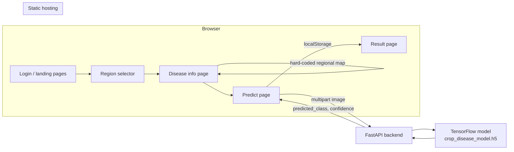

<div align="center">

<h1>AgriGuard</h1>

<p><strong>A crop-disease diagnosis prototype that pairs a TensorFlow image classifier with a lightweight, region-aware web interface for farmers.</strong></p>

[](LICENSE)
[](https://fastapi.tiangolo.com/)
[](https://www.tensorflow.org/)
[](#tech-stack)
[](https://www.python.org/)
[](#model-and-classes)
[](#credits)

</div>

> **Project status:** AgriGuard is a hackathon prototype. It is not a substitute for an agronomist, and its regional disease lists and remedy text are illustrative rather than live advisory data. See [Limitations](#limitations).

## Overview

Crop diseases are often identified late, after visible damage has reduced yield. A farmer may have a phone camera but no immediate access to an extension officer. AgriGuard explores a simple workflow: upload a leaf photo, receive a predicted disease class and confidence score, then view practical next steps and region-specific disease information.

The project was built for the **IEEE Promptathon 2025** by **Team 916X3**, where it received **3rd Prize**. It combines a FastAPI inference service, a TensorFlow CNN trained on 15 PlantVillage classes, and a static HTML/CSS/JavaScript frontend with an organic, glassmorphism-inspired visual identity.

## What is implemented

| Area | Status |
|---|---|
| Leaf-image upload with type and 10 MB size validation | Implemented in `frontend/js/script.js` |
| `POST /predict` inference with confidence score | Implemented in `backend/main.py` |
| 15-class PlantVillage classifier | Implemented; trained weights are not committed |
| Region selector with top-five disease lists | Implemented as a hard-coded map for four states |
| Organic/inorganic remedy panel | Implemented with generic guidance and search links |
| External marketplace links (Kisaan Mart, Amazon searches) | Implemented as outbound links |
| Login and registration screens | **Frontend demo only**; no auth backend |
| Live outbreak data, weather data, or geospatial mapping | Not implemented |
| Automated tests, CI, and container packaging | Not included |

## Features

- **Image-based diagnosis.** The backend resizes an uploaded image to 128×128, normalizes pixel values, and returns the highest-probability class with its confidence.
- **Fifteen supported classes.** The model covers bell pepper, potato, and tomato diseases, including healthy classes. The exact labels are stored in `backend/model/model_output/class_names.json`.
- **Guided upload experience.** The frontend previews the selected image, rejects unsupported file types, enforces a 10 MB limit, and stores the result for the result page.
- **Regional disease context.** A region selector links to a page that shows five common diseases for Tamil Nadu, Karnataka, Kerala, or Maharashtra, with a generic fallback for other selections.
- **Remedy and resource panel.** Disease cards open a modal with organic or inorganic guidance, application cadence, land-area dosing guidance, and outbound links to tools and chemical searches.
- **Marketplace hand-off.** The interface links to the external Kisaan Mart site and to product searches; it does not process transactions.
- **Responsive static frontend.** No build step, bundler, or JavaScript framework is required.

## Architecture



The frontend and backend are decoupled. The browser holds no model code; it sends the image to the API and renders the JSON response. `frontend/js/script.js` contains the API URL as a source constant, so local development requires pointing it at the local backend (see [Run the frontend](#3-run-the-frontend)).

## Tech stack

| Layer | Technology | Role |
|---|---|---|
| Frontend | HTML5, CSS3, vanilla JavaScript | Multi-page UI, upload flow, result rendering |
| Backend | FastAPI 0.122.0 | Image upload endpoint and JSON API |
| Server | Uvicorn 0.38.0 | ASGI development server |
| ML | TensorFlow 2.20.0 / Keras | CNN training and inference |
| Data | NumPy 2.3.5 | Image array preprocessing |
| Uploads | python-multipart 0.0.20 | Multipart form handling |
| ML training | Keras `ImageDataGenerator` | 80/20 train-validation split |
| Config | `netlify.toml` | Partial Netlify build configuration |

## Model and classes

`backend/model/train_model.py` defines a small convolutional neural network:

- Three `Conv2D` blocks with 32, 64, and 128 filters, each followed by batch normalization and 2×2 max pooling
- `Flatten`, a 256-unit dense layer, and dropout at 0.4
- A softmax output sized to the number of training classes
- Adam optimizer, categorical cross-entropy, and accuracy tracking
- 10 epochs with early stopping on `val_loss` (patience 3, best weights restored)

Inputs are 128×128 RGB images rescaled to `[0, 1]`. Training uses an 80/20 `validation_split` of the ImageFolder-style dataset. The script writes the ordered class list to `class_names.json` and the trained model to `crop_disease_model.h5`.

The 15 labels in the checked-in class list are:

```text
Pepper__bell___Bacterial_spot
Pepper__bell___healthy
Potato___Early_blight
Potato___Late_blight
Potato___healthy
Tomato_Bacterial_spot
Tomato_Early_blight
Tomato_Late_blight
Tomato_Leaf_Mold
Tomato_Septoria_leaf_spot
Tomato_Spider_mites_Two_spotted_spider_mite
Tomato__Target_Spot
Tomato__Tomato_YellowLeaf__Curl_Virus
Tomato__Tomato_mosaic_virus
Tomato_healthy
```

The dataset is expected at `backend/model/dataset_raw/PlantVillage/<class_name>/<images>`. Dataset images and the `.h5` model are ignored by Git to keep the repository small. **A fresh clone therefore cannot start the backend until either a compatible model file is supplied or the model is trained locally.**

## Project structure

```text
AgriGuard/
├── backend/
│   ├── main.py                     # FastAPI app, model loading, / and /predict
│   ├── requirements.txt            # Pinned Python dependencies
│   └── model/
│       ├── train_model.py          # CNN training script
│       └── model_output/
│           └── class_names.json    # Ordered class labels (model .h5 is ignored)
├── frontend/
│   ├── index.html                  # Login/signup demo
│   ├── homepage2.html              # Landing page
│   ├── page3.html                  # Region selector
│   ├── diseases.html               # Regional disease cards and remedy modal
│   ├── predict.html                # Upload page
│   ├── result.html                 # Diagnosis result and remedy links
│   ├── js/script.js                # Upload, API call, response handling
│   └── assets/images/              # Local imagery used by the UI
├── docs/
│   ├── AgriGuard-Revolutionizing-Farming-with-AI-Sustainability.pptx
│   └── AgriGuard Link.txt
├── netlify.toml
└── README.md
```

The `docs/` folder contains the original presentation and an external short link. Neither is required to run the application.

## Prerequisites

- Python 3.11 or newer
- `pip`
- A modern browser
- The PlantVillage dataset **or** a compatible `crop_disease_model.h5` for inference
- A static file server for the frontend; Python's `http.server` is sufficient

TensorFlow is a large dependency. Using a fresh virtual environment is strongly recommended.

## Setup

```bash
git clone https://github.com/ishanvaidya01/AgriGuard.git
cd AgriGuard

python -m venv .venv
# Windows PowerShell
.venv\Scripts\Activate.ps1
# macOS / Linux
source .venv/bin/activate

pip install -r backend/requirements.txt
```

### 1. Provide the model

**Option A — use an existing checkpoint.** Place a compatible Keras model at:

```text
backend/model/model_output/crop_disease_model.h5
```

The file is ignored by Git and is not part of the repository. The class order must match `backend/model/model_output/class_names.json`.

**Option B — train from the dataset.** Download PlantVillage and arrange it at `backend/model/dataset_raw/PlantVillage/<class_name>/`. From the repository root:

```bash
python backend/model/train_model.py
```

The script uses relative paths, so run it from the repository root, not from inside `backend/`. It writes both the model and the class mapping into `backend/model/model_output/`.

## Run

### 1. Run the backend

From the repository root:

```bash
python backend/main.py
```

The API listens on `http://localhost:8000`. Starting from the repository root also keeps the relative `class_names.json` path valid. If you prefer Uvicorn directly:

```bash
uvicorn backend.main:app --host 0.0.0.0 --port 8000 --reload
```

### 2. Point the frontend at the backend

The checked-in `frontend/js/script.js` contains:

```javascript
const API_URL = "https://viridion-s.onrender.com/predict";
```

That is a hosted endpoint referenced by the original project; its availability is not guaranteed. For local development, change the constant to:

```javascript
const API_URL = "http://localhost:8000/predict";
```

The backend allows cross-origin requests, so a frontend served from a different local port can call it.

### 3. Run the frontend

```bash
cd frontend
python -m http.server 3000
```

Open <http://localhost:3000>. The entry page is `index.html`; the usable flow continues through `homepage2.html`, `page3.html`, `diseases.html`, and `predict.html`.

The login and registration forms are visual demos implemented in browser JavaScript. They do not create accounts and do not protect any route.

## Environment variables

The backend reads **no environment variables**. The listening host and port are hard-coded in `backend/main.py`; the frontend API URL is a source constant rather than a runtime setting.

`netlify.toml` sets `PYTHON_VERSION = "3.11"` for Netlify's build environment. This affects Netlify builds only and does not configure the FastAPI application.

No `.env` file is required. Do not add secrets to the frontend: all browser-delivered JavaScript is public.

## API

Base URL for local development: `http://localhost:8000`

| Method | Path | Request | Response |
|---|---|---|---|
| `GET` | `/` | None | `{"message": "GreenGuardian API is alive"}` |
| `POST` | `/predict` | `multipart/form-data` with a `file` field | `{"predicted_class": "...", "confidence": 0.0-1.0}` |

Example:

```bash
curl.exe -X POST http://localhost:8000/predict \
  -F "file=@frontend/assets/images/rice_blast_1.jpg"
```

The endpoint does not define an explicit error schema. Invalid images, a missing model file, or a write failure surface as server errors; the frontend displays a generic failure message and suggests checking that the backend is running.

## Usage

1. Open the frontend and continue past the demo login screen.
2. Select a region to view its regional disease cards, or go directly to the diagnosis page.
3. Upload a JPG, PNG, GIF, or WebP image no larger than 10 MB.
4. Run the prediction. The result page shows the raw class label and confidence, plus organic and inorganic resource links.
5. Treat the result as a screening signal. Confirm the diagnosis with a local agricultural extension officer before applying any treatment.

Uploaded images are sent to the configured backend and written to a temporary path during inference. Do not upload sensitive or unrelated personal images.

## Testing

No automated tests are included. A smoke test after starting the backend:

```bash
curl.exe http://localhost:8000/
curl.exe -X POST http://localhost:8000/predict \
  -F "file=@frontend/assets/images/rice_blast_1.jpg"
```

Expected shape of the second response:

```json
{
  "predicted_class": "Rice_Blast",
  "confidence": 0.93
}
```

The exact class and confidence will differ by model checkpoint and image; the example is illustrative, not a benchmark result. For frontend checks, upload one valid image, one unsupported file type, and one file over 10 MB, then confirm the result page reads the value stored in `localStorage`.

## Deployment

### Netlify (frontend)

`netlify.toml` currently declares a Python version and a functions directory:

```toml
[build.environment]
PYTHON_VERSION = "3.11"

[functions]
directory = "netlify/functions"
```

It does **not** define a build command, a publish directory, or any serverless functions, and the repository contains no `netlify/functions` directory. Deploying the static frontend therefore requires one of:

- Configuring the Netlify site with base directory `frontend`, no build command, and publish directory `frontend`, or
- Adding `publish = "frontend"` to `netlify.toml` before deployment.

The FastAPI backend cannot run as a purely static Netlify site. Host it on a Python-capable service, then update `API_URL` in `frontend/js/script.js` to the public HTTPS endpoint. Because the backend currently allows all origins, consider restricting CORS before exposing it publicly.

### Backend hosting

The repository includes no Dockerfile, Procfile, or platform-specific backend configuration. Any platform that can install `backend/requirements.txt`, provide the `.h5` model, and run Uvicorn on a public port can host the API. Model size and TensorFlow memory use should be checked against the chosen plan.

## Limitations

- **Not field-validated.** PlantVillage is largely composed of controlled-condition leaf images. Performance on phone photos, complex backgrounds, multiple leaves, or local crop varieties may be substantially lower. The repository contains no evaluation report or held-out field benchmark.
- **Narrow class coverage.** Only 15 pepper, potato, and tomato classes are supported. A prediction is always forced into one of them, even for an unrelated image.
- **No confidence calibration or abstention.** The UI displays softmax confidence but does not detect out-of-distribution inputs or recommend a second opinion.
- **Model artifacts are not versioned.** The repository does not include the `.h5` file or the dataset, so reproducibility depends on the user supplying both.
- **Regional data is static.** The four-state disease map and the five-item lists are hard-coded in `diseases.html`. They are not connected to outbreak surveillance, weather, or geospatial services.
- **Remedy content is generic.** The modal provides general guidance and outbound search links, not crop-, dose-, or jurisdiction-specific recommendations. Always follow local label instructions and extension guidance.
- **Authentication is a mock-up.** Login and registration do not persist or verify credentials.
- **No automated tests or CI.** Regressions in the API contract or UI flow are not caught automatically.

## Contributing

Contributions are welcome. Read [CONTRIBUTING.md](CONTRIBUTING.md) for setup, branch naming, Conventional Commits, and the pull-request checklist. Community participation is covered by [CODE_OF_CONDUCT.md](CODE_OF_CONDUCT.md).

Report vulnerabilities privately as described in [SECURITY.md](SECURITY.md). Do not open a public issue for a security problem.

## License

The source code is released under the MIT License. See [LICENSE](LICENSE) for details.

The PlantVillage dataset and any third-party images or links retain their own terms. They are not relicensed by this repository.

## Credits

**Team 916X3** — IEEE Promptathon 2025, 3rd Prize

- **Ishan Vaidya** — frontend and backend integration
- Project presentation and additional assets are in `docs/`

## Acknowledgements

- [PlantVillage](https://plantvillage.psu.edu/) for the public crop-disease dataset used to train the classifier
- [FastAPI](https://fastapi.tiangolo.com/) and [TensorFlow](https://www.tensorflow.org/) for the backend and model tooling
- [Kisaan Mart](https://kisaan-mart-29f1ef75.base44.app/) for the external marketplace link referenced by the UI
- The open-source Python and JavaScript communities

## Contact

Maintainer: **Ishan Vaidya** — [ishan.vaidya01@gmail.com](mailto:ishan.vaidya01@gmail.com)
